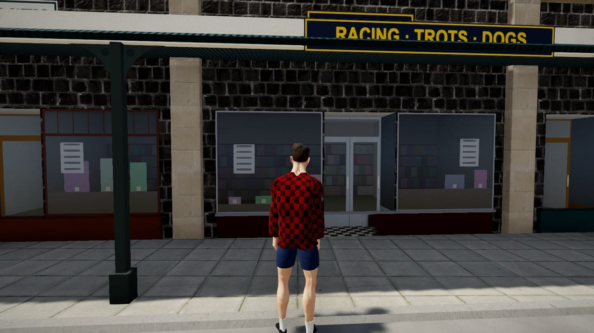
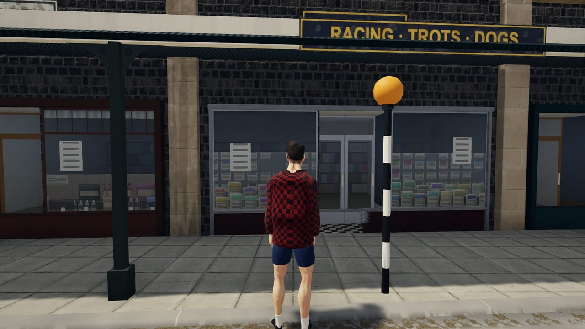
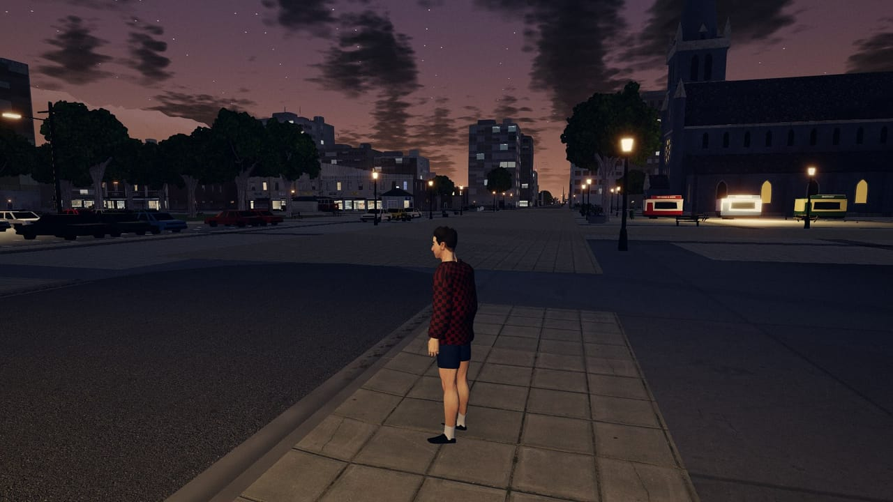
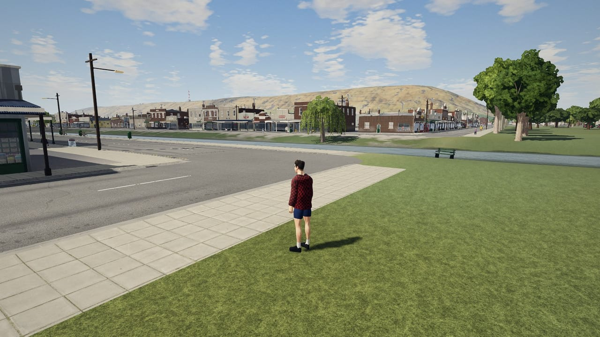
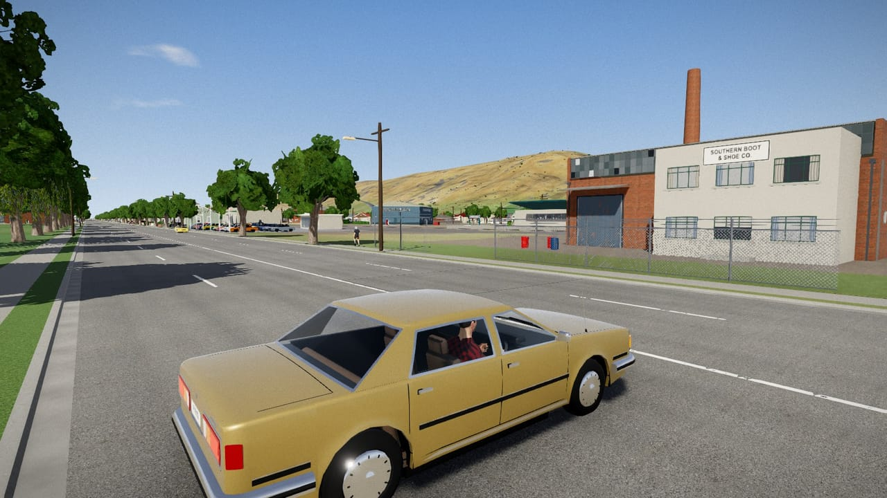
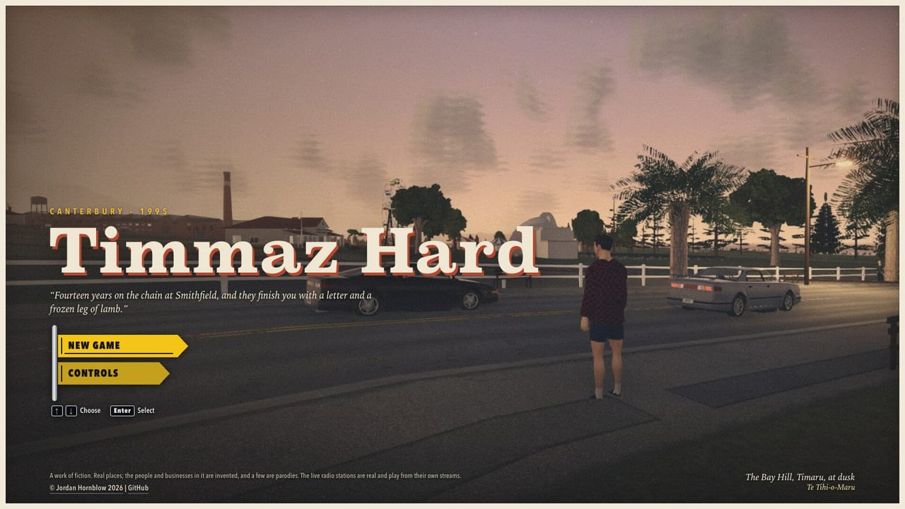
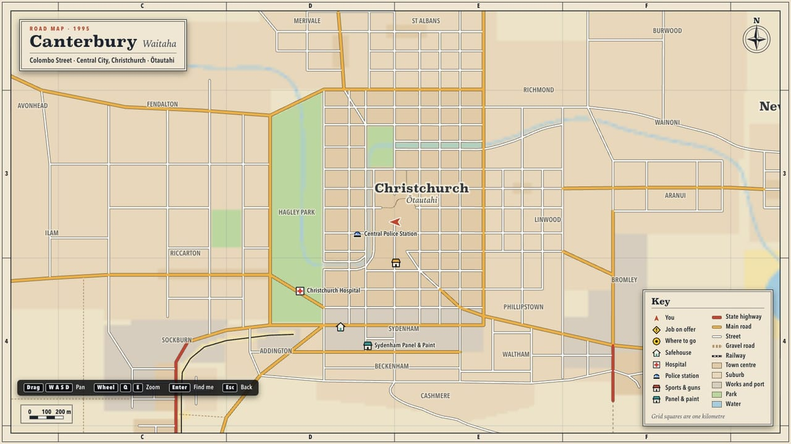

# Timmaz Hard: where it stands

Canterbury, 1995. An original open-world crime sandbox for the browser: Vite, TypeScript, Three.js, Rapier. This is the plain account: what works, what is rough, what was cut, and what was measured.

`pnpm dev` runs it. `pnpm build` type-checks and writes a self-contained `dist/` (21 MB, 135 files, hashed names, relative paths). 1,232 unit tests pass.

It is live at <https://timmaz-hard.603.nz>: a private S3 bucket behind CloudFront, deployed from `main` by CodeBuild (`infrastructure/README.md`).

## What works

Checked by running the game, mostly through the headless playtest scripts in `scripts/playtest/` (the commands are in the README).

- **Start to finish.** New game starts on the Bay Hill in Timaru. All six missions complete back to back in one session with the scripted test player, ending with NZ$12,100 and no console errors. Saving, reloading and Continue bring back money and position (`scripts/playtest/continue.mjs`); dying and being arrested each cost a fee and put you back at the hospital or police station.
- **On foot.** Walk, run, jump, punch, aim over the shoulder and shoot. Fists, cricket bat, pistol, pump shotgun and .22 rifle; health, armour, cash and weapon pickups.
- **Vehicles.** Eleven: two big sedans, a coupe, a hatch, a wagon, a ute, a farm truck, a van, a motorbike, a police car and a bus. Parked ones can be taken and occupied ones hijacked (seen by a bystander, that is one light of heat). They take damage, catch fire and explode; they skid, smoke and leave marks. Fast vehicles knock over lamp posts, signs, bins, benches and fences; slow ones are stopped by them.
- **Police.** Five levels. Crimes count only when witnessed. A three-light pursuit in Christchurch was sighted within ten seconds, had a roadblock across Moorhouse Avenue in about twenty, and had wrecked the test driver's car by thirty-five (`scripts/playtest/chase.js`). From three lights they shoot.
- **Losing the police.** At two lights, in the car they were looking for: run until no patrol car has eyes on you, ditch it for another, drive off quietly, and the lights are out 35 seconds after they came on (`scripts/playtest/escape.js`). It was an easy case, and nobody has tried it by hand at three lights and up, where they shoot and block roads.
- **Combat.** A four-against-one shoot-out fought by an aim-and-fire bot with only what the mission hands out (pistol, half armour) was won in 11 seconds for 29 points of damage (`scripts/playtest/fight.js`). That figure is from before the art pass and was not re-run.
- **The world.** A compressed Christchurch (the four avenues, Cathedral Square with the cathedral standing, Colombo Street, the Avon, Hagley Park, the Arts Centre, suburbs, Lancaster Park, New Brighton, the Port Hills and Summit Road, the tunnel to Lyttelton) and Timaru (Stafford Street, the Bay Hill, Caroline Bay with its sound shell and carnival, the port, the basilica, Washdyke, Smithfield), joined by State Highway 1 across the plains through Rakaia, Ashburton and Temuka, with the Rakaia and Rangitata bridges and the Alps on the western horizon. Real place and street names, te reo names in the HUD and map, marae in the landscape.
- **How it looks.** A film-style grade that shifts with the weather, haze in the distance, clouds that cast moving shadows, and nights that are dark between sodium lamps. Buildings carry grime, streaks, rust and faded paint, and shop windows show goods. Roads have wheel tracks, patches, cracks and the painted furniture of a 1995 town: STOP and GIVE WAY, zebra crossings, parking bays, cat's-eyes. Cars have shaped bodies, real lamps, cabins, road film and trim that differs from car to car. Trees come in several shapes, and there are flower beds, hedges and long grass. Streets have meters, signs and name blades with the real street names.
- **Life.** Pedestrians and traffic that follow the roads, keep left and react; drivers you can see at the wheel; boy racers at night; a heritage tram working the city loop, which traffic queues behind and which stops for anything on its track.
- **Familiar faces.** Eleven look-alike parodies of 1995's public figures, under invented names, stand at set places in daytime and say their lines as you walk up; the weatherman comments on the weather the game is actually having. Three have a line in a mission. They cannot be hurt. The cast is one file, `src/missions/defs/cameos.ts`.
- **Sky and sound.** Day and night, clear, nor'wester (with the arch), overcast, southerly rain and fog; wet roads with puddles; ten real New Zealand radio stations streamed live in cars (all ten connected and played when tested with `scripts/playtest/radio.js`), six synthesised stations after them on the dial; synthesised engines, effects and ambience.
- **Interface.** A title screen that is a photograph of the game, a HUD in one type system, a paper minimap, the island map as a page from a road atlas with grid, scale and key, and a pause menu with jobs, controls, settings (four quality levels) and save.
- **Phones.** An on-screen controller on touch devices (stick, look by dragging, and buttons that change between walking, driving and being armed), a lighter quality tier, a "turn your phone" card in portrait, and home-screen support. Chrome's phone emulation, driven with real touch events, passes 63 of 63 checks: walking, looking, taking a car, driving, weapons, every pause screen and the map (`node scripts/playtest/phone.mjs`).

## What is rough

- **Nobody has played it through by hand.** The scripted player teleports the long drives and, except in the one fight tested honestly, wins fights by cheating. Mission difficulty, timers and police lethality are therefore unbalanced guesses. Mouse look under pointer lock and gamepads are untested.
- **It has not been run on a phone.** There is no iPhone or simulator on the machine it was built on. Chrome's emulation is not Safari: safe areas on both rotations, the left-edge swipe, zoom and bounce, sound starting on the first tap, the live radio starting by itself in a car, sound returning after the phone is locked, pinch zoom on the map, installing to the home screen, and ten minutes without the tab reloading all need checking on a real one. How fast it runs on a phone is unknown. (The touch playtest passes 63 of 63 when it passes, but one timing-sensitive check — tapping the fire button mid-sequence — is flaky and can fail even on a quiet machine; a re-run normally clears it.)
- **Stafford Street** is still sparser than the Christchurch shop streets.
- **Hair is the same few shapes**, and the familiar faces are simple: the likeness is in the name, the place and the lines, not the face, and nobody carries a prop.
- **The motorbike and the bus** are the plainest of the eleven vehicles (their riders and drivers sit properly now, but the bodies had the least time spent on them).
- **A glitch seen twice and not found.** During the art pass two screenshots came back covered in large dark planes. 138 reruns and four drives did not reproduce it; the likeliest cause is a page that loaded while another agent was half-way through an edit, but that is unproven.
- **First-time shader compiles stall a frame.** The first time an effect appears in a session the browser compiles its program — up to 135 ms, once each. With chunk building now sliced (see below), these are what is left of the long frames: one 42 ms frame in the 22-second highway drive, none over 20 ms from chunk work.
- **Live radio leans on other people.** The ten real stations play from their own public streams with no arrangement in place: an address can change or a station can object, and then that line in `src/audio/radio/live.ts` has to go. What they broadcast is today's radio, not 1995's.
- **Integrated graphics are unmeasured.** Every number below is from one M2 Max.

## Fixed since the art pass

Each checked by running the game, with the playtest scripts named.

- **Tree trunks faded with their crowns.** The wood had no part in the 120 m dissolve and popped; it now dissolves with the leaves. Driving past Hagley Park, the worst tree switch changed the picture 1.12 times what the motion alone did, down from 1.23 (`scripts/playtest/lodwatch.js`).
- **The dark crease at the women's mouth.** It was the normal map, not the skin: the philtrum groove, mouth-corner curls and chin fold were cut too deep in the source texture. The character build now calms the map around the mouth; checked in the viewer on light and dark skin.
- **The stick-up cameos.** The two who raised both arms to speak now hold forth with one open hand raised (a new `orate` pose, derived like the others at load).
- **AI driving.** Three faults: a degenerate junction connector could pin a car at the end of an edge and send it across the riverbank on full lock; sharp-turn curves could swing far outside the junction (across City Mall); and a car knocked off its lane had no way back. Cars now avoid hairpin exits when wandering, rejoin the road when well off their lane, sharp connectors stay inside the junction box, and parked cars keep 22 m clear of junctions, which ended the clipped parked cars at corners. Watched four minutes at each of the two worst corners (`scripts/playtest/roadwatch.js`): off-road events fell from 32 to 4 and 26 to 3, none further than a wheel over the seal at walking pace, and no parked car was touched.
- **The 43 ms frame after a teleport** was a single chunk-build step too big for its 4 ms budget — the whole Arts Centre in one go. Heavy builds are sliced now (the Arts Centre and Cathedral Square a stage per frame, roads an edge and rails a line per frame); the worst single step fell from 20 ms to 10 ms (`world.slowJob` records it) and the chunk system's whole cost in the worst frame of a town drive after a teleport is 12 ms.
- **Drivers are seated properly.** The stand-in occupant grew shins and shoes that reach the footwell (deeper in a bus or truck cab), and the motorbike rider's knees go out round the tank with the shins dropping to the footpegs, which moved back to where a rider's feet sit.
- **Traffic signals are lit.** The aspects glow and the town runs one controller cycle — green one axis while the other holds red, amber and a beat of all-red between — with crossing roads on opposite phases.
- **Suburban back yards are lived in**: trampolines, veggie patches, kennels, incinerator drums and woodpiles behind the fences, and driveways cross the berm and footpath to the kerb in a concrete slab.
- **Landmark detail.** The cathedral's west front gained flanking buttresses, a string course, three stepped arch orders round a mullioned double door, stone steps and a service board; Lancaster Park's turnstile bays carry GATE numbers and the Saturday fixture is chalked up by the gate.
- **People.** Lips in their own depth of colour, heavier or lighter brow lines, hairlines worn higher or lower; and heads turn — a glance aside every few seconds, eased in and out, held still by any pose that owns the head.
- **Buildings.** Old painted signs lose their paint to the wall: where the lettering has flaked the fragment is discarded and the brick behind shows through. Streaks are tied to their sources: rain runs off the ends of some masonry sills and down from a leaking joint on half the downpipes.
- **Wet roads reflect the lights.** Under each lit street lamp a streak of its colour lies on the seal, stretched towards the viewer, fading as the road dries.
- **Steep hillsides.** The crag noise blends to a side-on projection on steep faces so it cannot smear into long streaks. The steepest face on the map (about 36°) reads clean, but the old far-hillside streaking could not be reproduced for a true before-and-after.

## What was cut

- Real map data. The first idea was to build from OpenStreetMap; the map is hand-authored and compressed instead.
- Moving trains on the Main South Line (the line, stations and bridges are there; level crossings would need traffic that understands them) and moving punts on the Avon.
- Building interiors, apart from what shows through shop windows.
- A submachine gun and swimming.
- CC0 vehicle models: none exist for period New Zealand cars, so vehicles are procedural.

## Measured frame rate

Apple M2 Max MacBook Pro, 1920 × 1080, quality High unless stated, frame rate uncapped, development server. `zsh scripts/playtest/measure.sh` reproduces the table (each place is `node scripts/shot.mjs … --fps 6 --size 1920x1080`, run twice). "Art pass" is that pass's own measurement; "Now" is a fresh run after the bug fixes and the polish on top of it (lit signals, lived-in yards, streak decals, wet reflections), which added content back in the suburbs.

| Place | Before | Art pass | Now | Draw calls now | Triangles now |
|---|---|---|---|---|---|
| The Bay Hill, Timaru (start) | 164–174 | 225–230 | 219–223 | 730–900 | 0.9–1.0 M |
| Linwood (suburban street) | 124–126 | 165–175 | 140–148 | 790–840 | 1.1–1.2 M |
| Moorhouse Avenue, night, southerly rain, in a car | 112–120 | 145–188 | 132–143 | 1,250 | 2.1 M |
| Hagley Park and the Avon | 104–106 | 110–135 | 102–103 | 910–1,320 | 1.4–2.1 M |
| Cathedral Square | 95–97 | 115–130 | 99–102 | 1,130–1,370 | 2.0–2.4 M |
| Cathedral Square, Low | 227 | 342 | 271 | 550 | 1.0 M |
| Cathedral Square, Medium | 129 | 150 | 132 | 960 | 1.7 M |
| Cathedral Square, Ultra | 60, at 70 % render scale | 76, at full scale | 70, at full scale | 1,440 | 2.5 M |
| State Highway 1 at about 100 km/h for 22 s | 158 average; worst 19 ms | 224 average; 99th-percentile 10 ms; worst 17 ms | 228 average; 99th-percentile 10 ms; worst 42 ms, once in 5,023 frames | | |

The slowest single standing frame at High was 19 ms (24 ms at Ultra). The polish gave back some of the art pass's gain where it added the most (Linwood's yards), and sits within this machine's ten-per-cent run-to-run variance elsewhere; the one 42 ms frame on the highway (crossing the Rakaia Bridge) is of the first-time-shader-compile kind noted above, not chunk work.

Where the saving came from: figures have four levels of detail (thirty pedestrians went from 1.46 M triangles to 0.22 M), trees and cars have cheap distant versions, and small props are drawn only in chunks near the camera. The street dressing costs about a tenth of the frame rate on Christchurch's one-way parking streets (Kilmore Street: 115–117 with it, 128–160 without).

## Screenshots

The same view before and after the art pass (`zsh scripts/gallery.sh` takes all 24).

| Before | After |
|---|---|
|  |  Stafford Street, Timaru |
|  |  A shopfront on Stafford Street |
|  |  Cathedral Square |
|  |  The Square at dusk |
|  |  A Linwood street |
|  |  The Avon and Hagley Park |
|  |  The plains under a nor'wester |
|  |  A car, close up |

| | |
|---|---|
|  The title screen |  The island map |
|  On a phone, driving |  On a phone, on foot and armed |
|  Moorhouse Avenue at night in a southerly |  Six of the eleven vehicles |

Earlier screenshots, from before the art pass, are still in `docs/screenshots/` (`01` to `16`): among them the roadblock that ended the test pursuit, the boat-shed fight, aiming, and the Warlock of the Square.

## Housekeeping

`shots/` (about 2.2 GB of working screenshots, plus each agent's notes from the art pass in `shots/round3/*-report.md`) and `assets-staging/` (about 1.4 GB of raw asset downloads) are scratch, ignored by `.gitignore`, and can be deleted; neither has been. `dev/` holds two viewer pages for the figures and the plants; they are not part of the build. (`src/vehicles/models/common.ts`, which nothing imported, is gone.)
