# Timmaz Hard: where it stands

Canterbury, 1995. An original open-world crime sandbox for the browser: Vite, TypeScript, Three.js, Rapier. This is the plain account: what works, what is rough, what was cut, and what was measured.

`pnpm dev` runs it. `pnpm build` type-checks and writes a self-contained `dist/` (20 MB, 130 files, hashed names, relative paths); that build was served from a sub-path and loaded and ran with no console errors or failed requests. 1,047 unit tests pass.

It is live at <https://timmaz-hard.603.nz>: a private S3 bucket behind CloudFront, deployed from `main` by CodeBuild (`infrastructure/README.md`). A new game started on that address in headless Chrome ran with no console errors or failed requests.

## What works

Checked by running the game, mostly through the headless playtest scripts in `scripts/playtest/` (the commands are in the README).

- **Start to finish.** New game starts on the Bay Hill in Timaru. All six missions complete back to back in one session with the scripted test player, ending with NZ$12,100 and no console errors. Saving, reloading and Continue bring back money and position (`scripts/playtest/continue.mjs`); dying and being arrested each cost a fee and put you back at the hospital or police station.
- **On foot.** Walk, run, jump, punch, aim over the shoulder and shoot. Fists, cricket bat, pistol, pump shotgun and .22 rifle; health, armour, cash and weapon pickups.
- **Vehicles.** Eleven: two big sedans, a coupe, a hatch, a wagon, a ute, a farm truck, a van, a motorbike, a police car and a bus. Parked ones can be taken and occupied ones hijacked (seen by a bystander, that is one light of heat). They take damage, catch fire and explode; they skid, smoke and leave marks. Fast vehicles knock over lamp posts, signs, bins, benches and fences; slow ones are stopped by them.
- **Police.** Five levels. Crimes count only when witnessed. A three-light pursuit in Christchurch was sighted within ten seconds, had a roadblock across Moorhouse Avenue in about twenty, and had wrecked the test driver's car by thirty-five (`scripts/playtest/chase.js`). From three lights they shoot.
- **Losing the police.** At two lights, in the car they were looking for: run until no patrol car has eyes on you, ditch it for another, drive off quietly, and the lights are out 35 seconds after they came on (`scripts/playtest/escape.js`). It was an easy case, the patrol cars never got closer than 200 m, and nobody has tried it by hand at three lights and up, where they shoot and block roads.
- **Combat.** A four-against-one shoot-out fought by an aim-and-fire bot with only what the mission hands out (pistol, half armour) was won in 11 seconds for 29 points of damage (`scripts/playtest/fight.js`).
- **The world.** A compressed Christchurch (the four avenues, Cathedral Square with the cathedral standing, Colombo Street, the Avon, Hagley Park, the Arts Centre, suburbs, Lancaster Park, New Brighton, the Port Hills and Summit Road, the tunnel to Lyttelton) and Timaru (Stafford Street, the Bay Hill, Caroline Bay with its sound shell and carnival, the port, the basilica, Washdyke, Smithfield), joined by State Highway 1 across the plains through Rakaia, Ashburton and Temuka, with the Rakaia and Rangitata bridges and the Alps on the western horizon. Real place and street names, te reo names in the HUD and map, marae in the landscape; every business, vehicle, radio station, gang and person is invented.
- **Life.** Pedestrians and traffic that follow the roads, keep left and react; drivers you can see at the wheel; boy racers at night; a heritage tram working the city loop, which traffic queues behind and which stops for anything on its track.
- **Sky and sound.** Day and night, clear, nor'wester (with the arch), overcast, southerly rain and fog; wet roads; six synthesised radio stations; synthesised engines, effects and ambience. Weather set by a mission or by hand now holds for four hours of game time instead of being re-rolled at once.
- **Interface.** HUD, rotating minimap, pause menu with the island map, jobs, controls, settings (four quality levels) and save.

## What is rough

- **Nobody has played it through by hand.** The scripted player teleports the long drives and, except in the one fight tested honestly, wins fights by cheating. Mission difficulty, timers and police lethality are therefore unbalanced guesses.
- **Mouse look under pointer lock and gamepads are untested.** The tooling drives the game by key events.
- **AI driving.** Better than it was: the guard rails that ran across side streets at the Avon bridges are gone (traffic crashes in a 45-second watch there fell from sixteen to four) and traffic sees the tram. Traffic and police still sometimes leave the road (a yard off High Street is one place), and cars turning into the Square from Colombo Street sometimes clip a parked one.
- **Vehicles, close up.** Right at chase distance, flat-panelled when you stand beside them. Lamps are flat panels. In the low cars the driver's shins go through the floor. Traffic and police drivers are 130-triangle stand-ins, not full figures.
- **Buildings, close up.** The backs and sides of the township hall, church hall, garage and farm sheds are plain, and yards behind shops are empty. Nothing is stained or streaked, painted wall signs look freshly done, and the brick is redder than Canterbury brick.
- **Ground and water.** The cliff faces at Lyttelton and Godley Head are smeared textures. Quays have no wall, just a bank. There are no pedestrian crossings, parking bays or STOP lettering. Chip seal is flat when you look straight down at it. The water races and the Timaru downs were not looked at.
- **Plants.** One shape per species and no cheaper far-away version; oak leaf cards show edge-on near the camera.
- **Dressing.** The Arts Centre and Lancaster Park have street furniture but nothing of their own. The Timaru start is over its draw-call budget (it still runs at over 160 frames a second here). Knocked-out fence posts leave their wires hanging.
- **Figures have no geometric level of detail.** Each is about 17,000 triangles; distant ones only stop casting shadows.
- **Integrated graphics are unmeasured.** Every number below is from one M2 Max.
- **Cathedral Square** is furnished but still wider and emptier at its edges than the real one, because building lots stop short of it.

## What was cut

- Real map data. The first idea was to build from OpenStreetMap; the map is hand-authored and compressed instead.
- Moving trains on the Main South Line (the line, stations and bridges are there; level crossings would need traffic that understands them) and moving punts on the Avon.
- Building interiors, apart from what shows through shop windows.
- A submachine gun, swimming, and any touch or mobile controls.
- CC0 vehicle models: none exist for period New Zealand cars, so vehicles are procedural.

## Measured frame rate

Apple M2 Max MacBook Pro, 1920 × 1080, quality High, frame rate uncapped, development server, the finished build. `zsh scripts/playtest/measure.sh` reproduces the table (each place is `node scripts/shot.mjs … --fps 6 --size 1920x1080`, run twice). Triangles include the shadow passes.

| Place | Frames per second | Draw calls | Triangles |
|---|---|---|---|
| The Bay Hill, Timaru (start) | 164–174 | 920–1,160 | 1.4–1.8 M |
| Linwood (suburban street) | 124–126 | 790–980 | 1.2–1.6 M |
| Moorhouse Avenue, night, southerly rain, in a car | 112–120 | 1,300 | 3.2 M |
| Hagley Park and the Avon | 104–106 | 1,080–1,580 | 2.5–3.7 M |
| Cathedral Square | 95–97 | 1,120–1,300 | 2.6–3.0 M |
| State Highway 1 at about 100 km/h for 22 s | 158 average; 99th-percentile frame 13 ms; worst 19 ms | | |

The slowest single frame in any of the ten standing runs was 15 ms, so nothing dropped below 60. Cathedral Square at the other settings: Low 227, Medium 129, Ultra 60 (Ultra only holds 60 there by dropping the render resolution to 70 %). The production build served from a sub-path measured 89 in the Square, the same as the development server within the spread between runs. That spread is about 10 %: an earlier pass the same day gave 136–140 in Linwood and 102–103 in the Square, and the machine was shared with other work throughout.

## Screenshots

All taken from the running game at 1600 × 900, quality High.

| | |
|---|---|
| 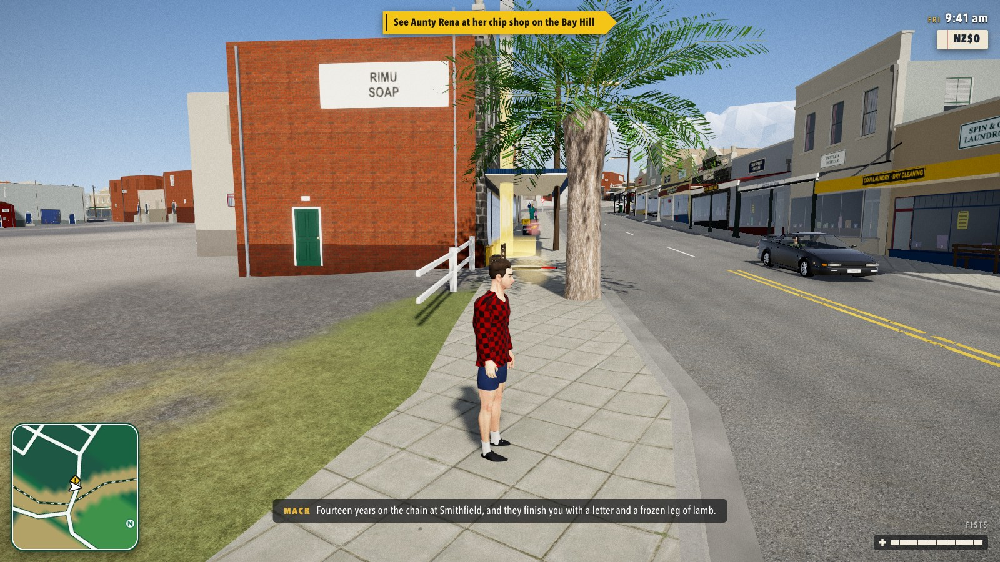 The Bay Hill, Timaru: where a new game starts | 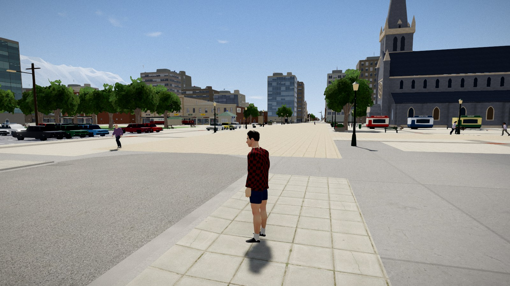 Cathedral Square |
| 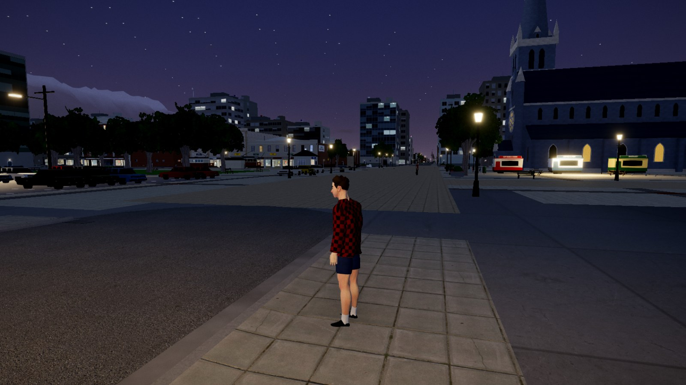 The Square at night | 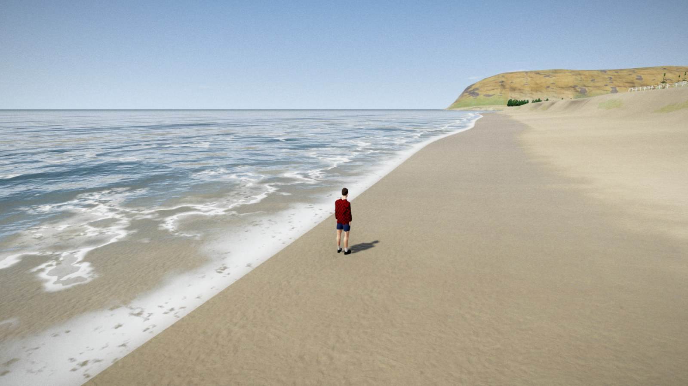 New Brighton beach |
| 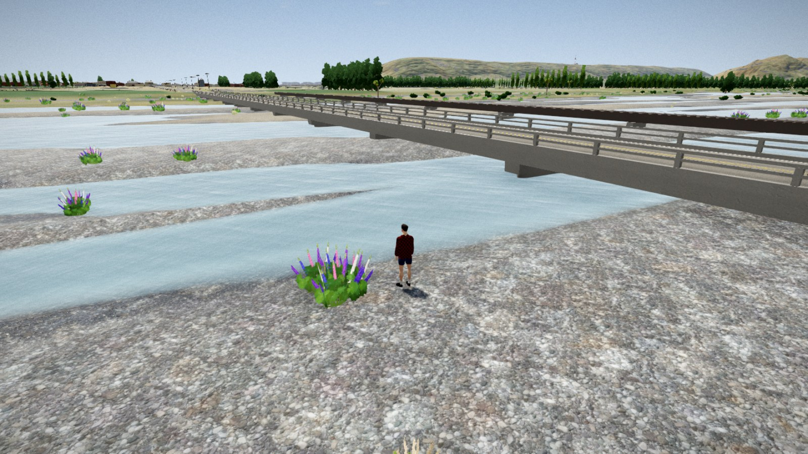 The Rakaia: shingle, braids and the road bridge | 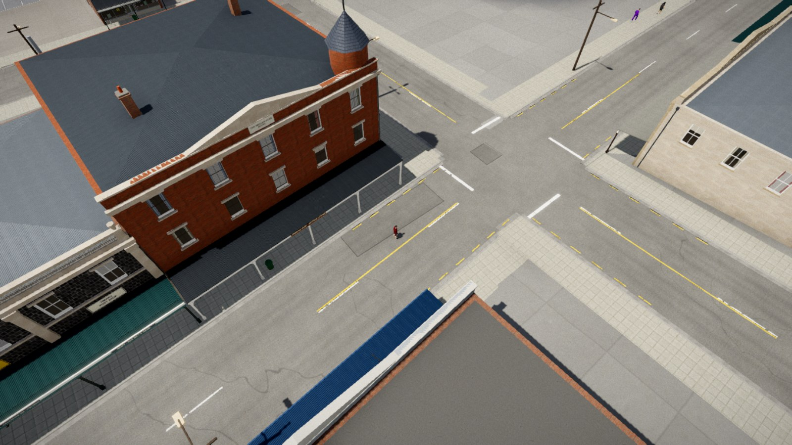 Stafford Street, Timaru |
| 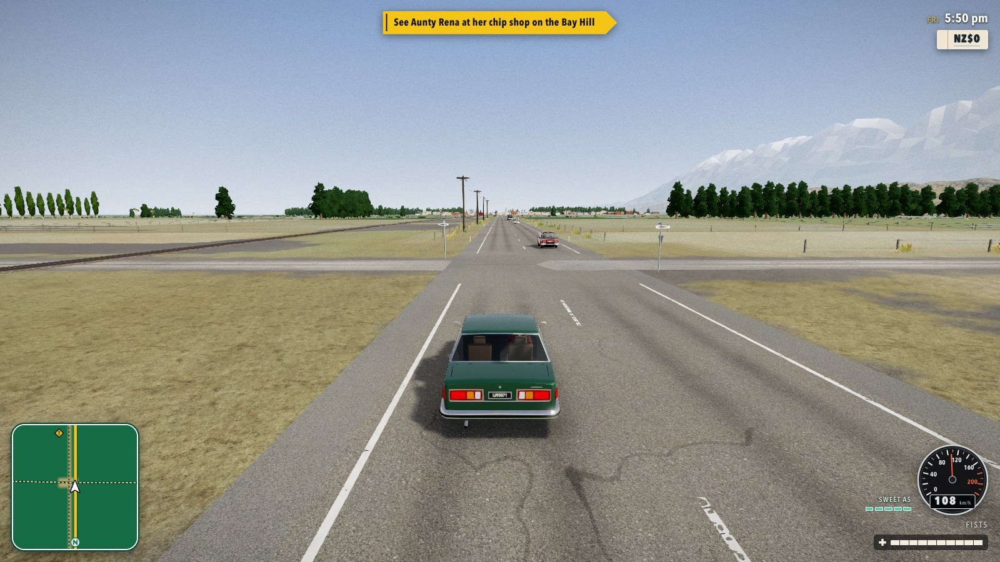 State Highway 1 under a nor'west arch | 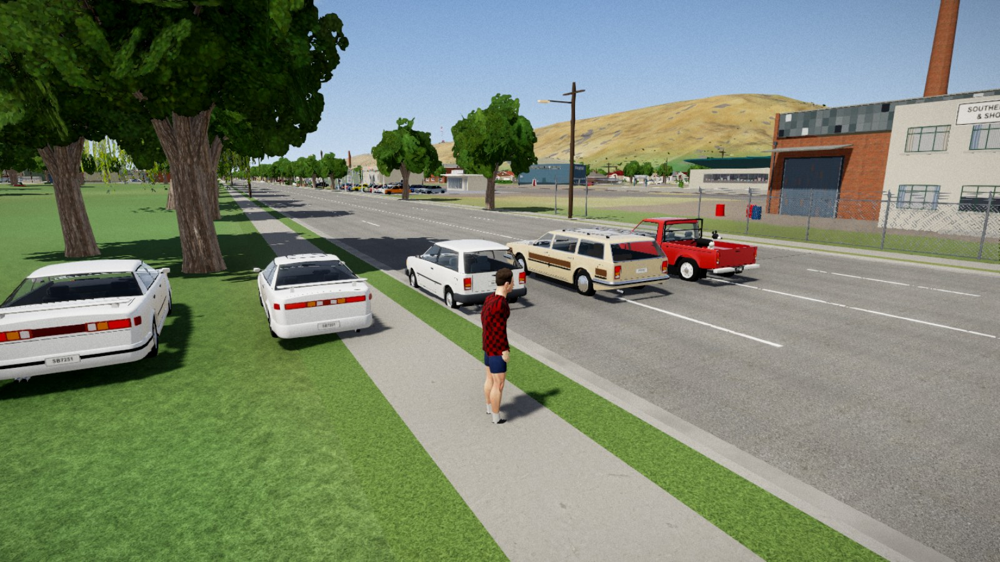 Some of the eleven vehicles |
| 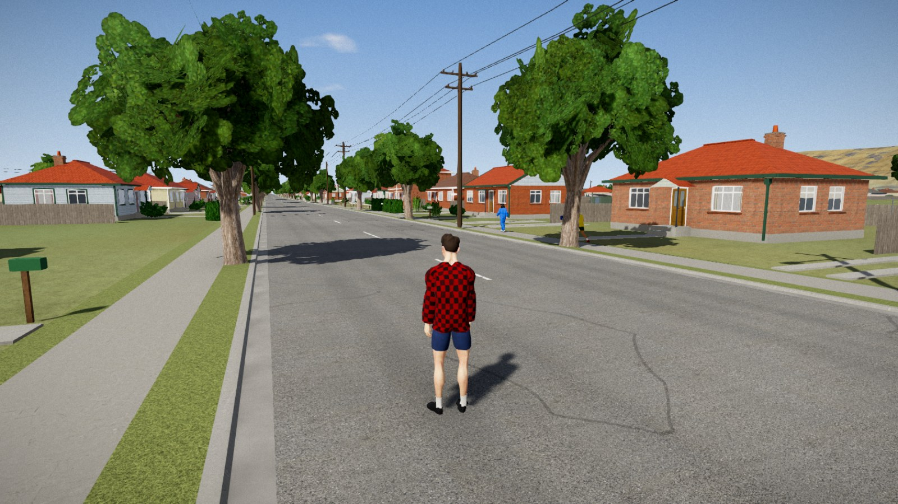 A Linwood street | 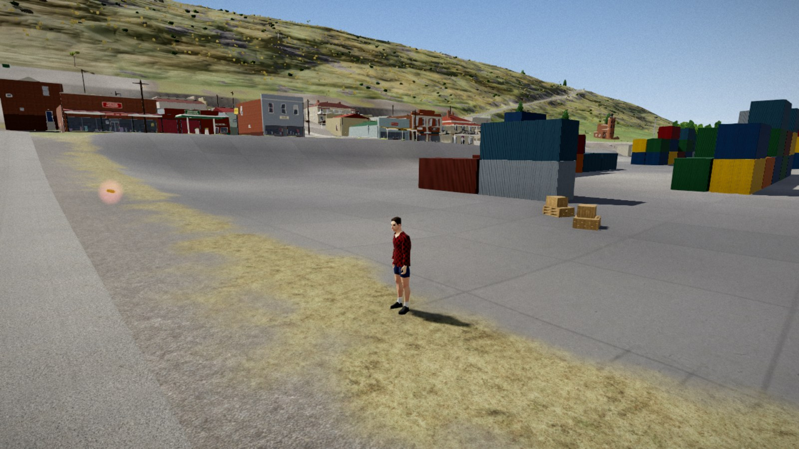 Lyttelton |
| 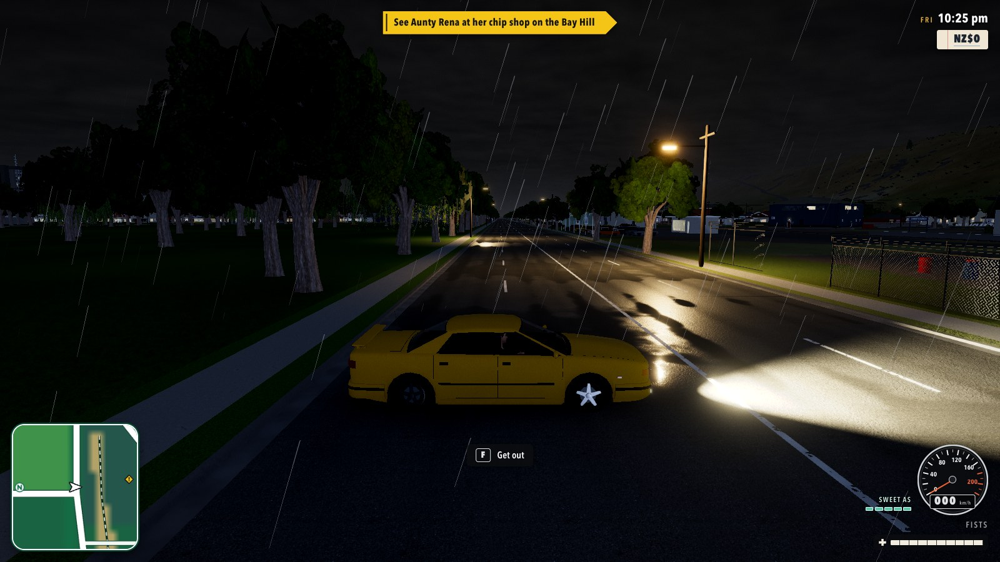 Moorhouse Avenue at night |  The Avon and Hagley Park |
| 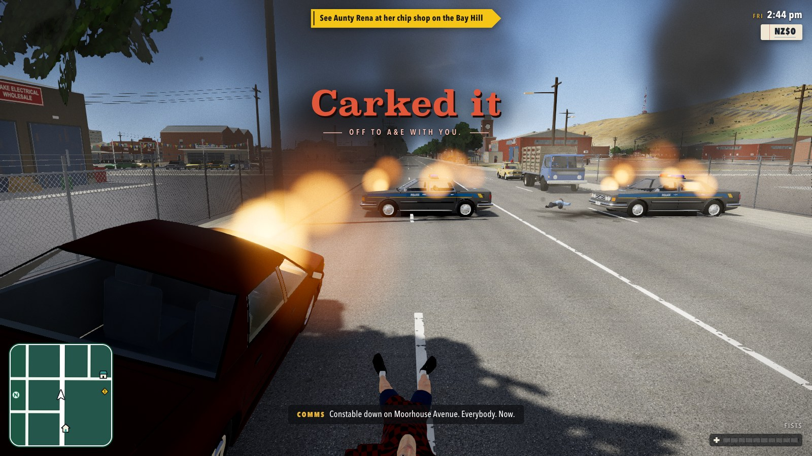 How the test pursuit ended | 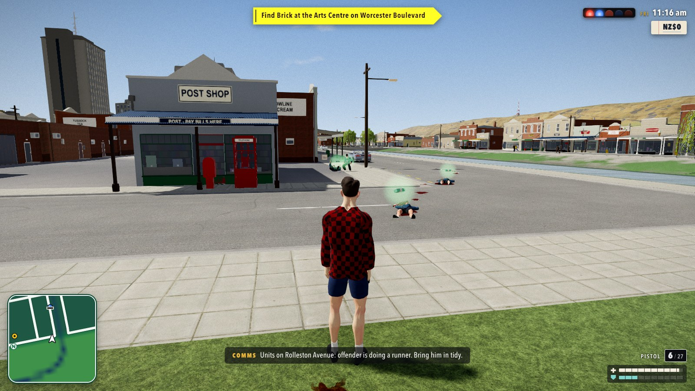 After the boat-shed fight |
| 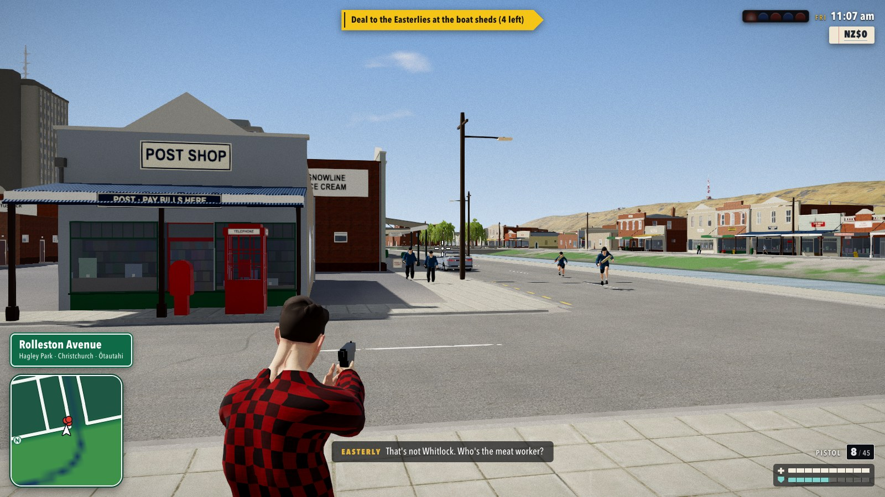 Aiming, at the start of the boat-shed fight | |

## Housekeeping

`shots/` (about 1 GB of working screenshots) and `assets-staging/` (about 1.4 GB of raw asset downloads) are scratch, ignored by `.gitignore`, and can be deleted. `dev/` holds two viewer pages for the figures and the plants; they are not part of the build. `src/vehicles/models/common.ts` is no longer imported by anything and can go too. I have deleted none of these.
