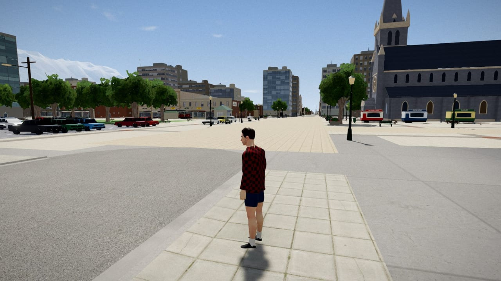
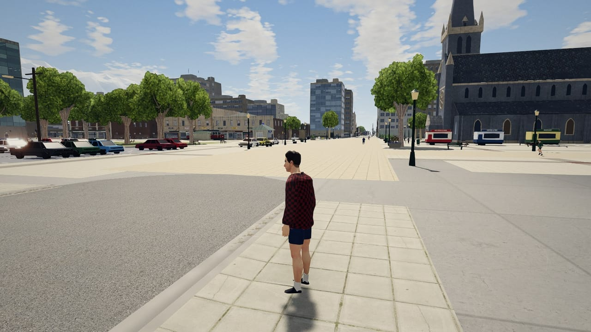
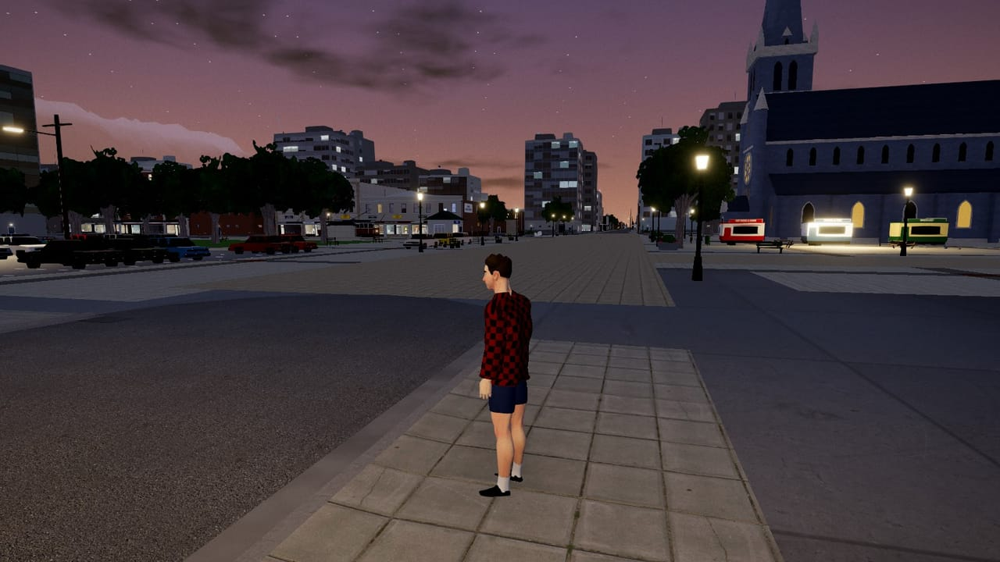
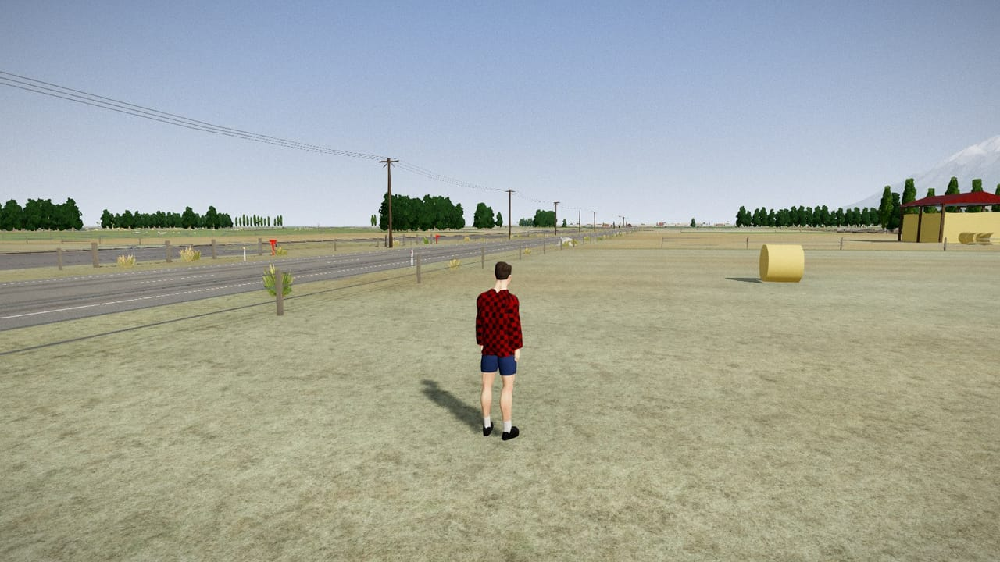
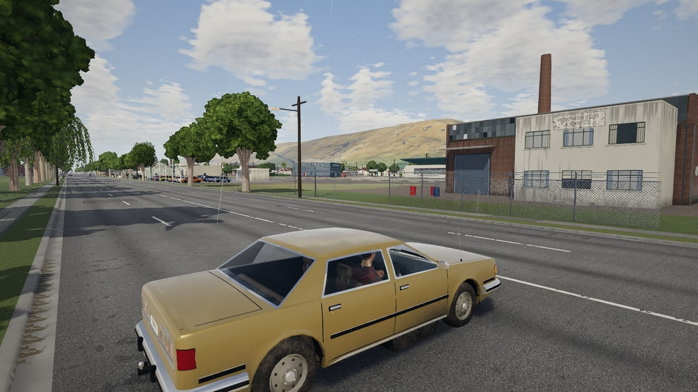
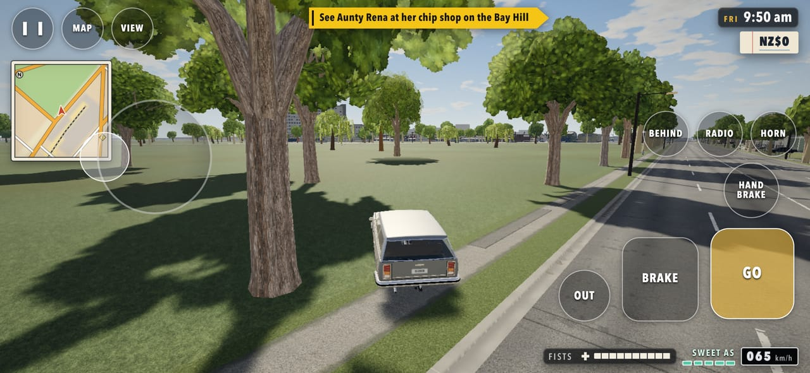
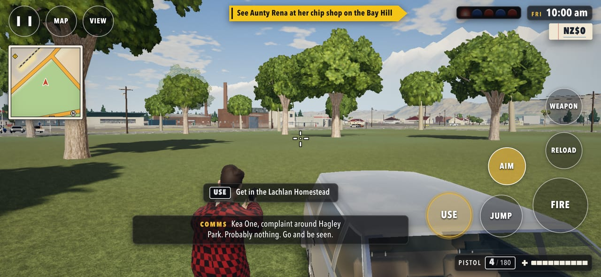
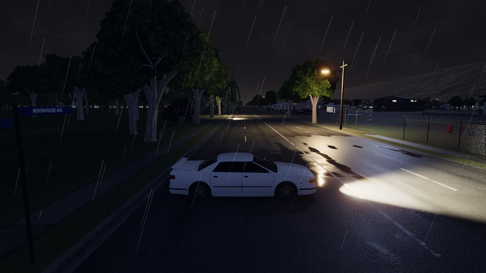

# Timmaz Hard: where it stands

Canterbury, 1995. An original open-world crime sandbox for the browser: Vite, TypeScript, Three.js, Rapier. This is the plain account: what works, what is rough, what was cut, and what was measured.

`pnpm dev` runs it. `pnpm build` type-checks and writes a self-contained `dist/` (21 MB, 135 files, hashed names, relative paths). 1,267 unit tests pass.

It is live at <https://timmaz-hard.603.nz>: a private S3 bucket behind CloudFront, deployed from `main` by CodeBuild (`infrastructure/README.md`).

## What works

Checked by running the game, mostly through the headless playtest scripts in `scripts/playtest/` (the commands are in the README).

- **Start to finish, honestly.** New game starts on the Bay Hill in Timaru. Played the way a player has to play — walking with the movement keys, driving every metre of every route, fighting with only what each mission hands out, losing the police the way the game intends — the honest test player (`node scripts/playtest/honest.mjs`) completes the whole story, with one caveat: it cannot reliably drive the Timaru-port delivery in the first job (an AI-driver limitation on the port approach, not a player one — see "The honest playtest" below; its latest run did pass it clean in 360 s). Missions two to six it plays through honestly, back to back, taking the game's own "have another go?" offer when it dies, as a player would — the finale's wharf last stand costs the most attempts, as a finale should, and ends with the story complete. The old scripted player (`scripts/playtest/missions.js`), which teleports and cheats to check logic rather than play, still passes all six, ending on NZ$12,100. Saving, reloading and Continue bring back money and position (`scripts/playtest/continue.mjs`); dying and being arrested each cost a fee and put you back at the hospital or police station.
- **On foot.** Walk, run, jump, punch, aim over the shoulder and shoot. Fists, cricket bat, pistol, pump shotgun and .22 rifle; health, armour, cash and weapon pickups.
- **Vehicles.** Eleven: two big sedans, a coupe, a hatch, a wagon, a ute, a farm truck, a van, a motorbike, a police car and a bus. Parked ones can be taken and occupied ones hijacked (seen by a bystander, that is one light of heat). They take damage, catch fire and explode; they skid, smoke and leave marks. Fast vehicles knock over lamp posts, signs, bins, benches and fences; slow ones are stopped by them.
- **Police.** Five levels. Crimes count only when witnessed. A three-light pursuit in Christchurch was sighted within ten seconds, had a roadblock across Moorhouse Avenue in about twenty, and had wrecked the test driver's car by thirty-five (`scripts/playtest/chase.js`). From three lights they shoot.
- **Losing the police.** At two lights, in the car they were looking for: run until no patrol car has eyes on you, ditch it for another, drive off quietly, and the lights are out 35 seconds after they came on (`scripts/playtest/escape.js`). At three lights the same method was tried twice and died twice (`scripts/playtest/escape3.js`) — which turned out to be a tuning bug, not fate: level-3 pursuit cruised at 46 m/s, faster than every car in the game bar two, so their line of sight never broke. Pursuit speeds at levels 2–4 came down (the reasoning is written next to the table in `src/police/response.ts`). Both intended outs now have honest proof at three lights: kerb the car unseen, go to ground off the road network on foot until the trail goes cold (sight is short at night, and cars cannot follow), or buy the respray when they know the car.
- **Combat.** A four-against-one shoot-out fought by an aim-and-fire bot with only what the mission hands out was re-run for this pass: 57–114 points of damage across runs — roughly four times the 29 measured before the art pass, against a 150-point pool. The mission kit was rebalanced (a full vest and more rounds in Punt Return); with it the same fight costs about 60 of a 200-point pool (`scripts/playtest/fight.js`).
- **The world.** A compressed Christchurch (the four avenues, Cathedral Square with the cathedral standing, Colombo Street, the Avon, Hagley Park, the Arts Centre, suburbs, Lancaster Park, New Brighton, the Port Hills and Summit Road, the tunnel to Lyttelton) and Timaru (Stafford Street, the Bay Hill, Caroline Bay with its sound shell and carnival, the port, the basilica, Washdyke, Smithfield), joined by State Highway 1 across the plains through Rakaia, Ashburton and Temuka, with the Rakaia and Rangitata bridges and the Alps on the western horizon. Real place and street names, te reo names in the HUD and map, marae in the landscape.
- **How it looks.** A film-style grade that shifts with the weather, haze in the distance, clouds that cast moving shadows, and nights that are dark between sodium lamps. Buildings carry grime, streaks, rust and faded paint, and shop windows show goods. Roads have wheel tracks, patches, cracks and the painted furniture of a 1995 town: STOP and GIVE WAY, zebra crossings, parking bays, cat's-eyes. Cars have shaped bodies, real lamps, cabins, road film and trim that differs from car to car. Trees come in several shapes, and there are flower beds, hedges and long grass. Streets have meters, signs and name blades with the real street names.
- **Life.** Pedestrians and traffic that follow the roads, keep left and react; drivers you can see at the wheel; boy racers at night; a heritage tram working the city loop, which traffic queues behind and which stops for anything on its track.
- **Familiar faces.** Eleven look-alike parodies of 1995's public figures, under invented names, stand at set places in daytime and say their lines as you walk up; the weatherman comments on the weather the game is actually having. Three have a line in a mission. They cannot be hurt. The cast is one file, `src/missions/defs/cameos.ts`.
- **Sky and sound.** Day and night, clear, nor'wester (with the arch), overcast, southerly rain and fog; wet roads with puddles; ten real New Zealand radio stations streamed live in cars (all ten connected and played when tested with `scripts/playtest/radio.js`), six synthesised stations after them on the dial; synthesised engines, effects and ambience.
- **Interface.** A title screen that is a photograph of the game, a HUD in one type system, a paper minimap, the island map as a page from a road atlas with grid, scale and key, and a pause menu with jobs, controls, settings (four quality levels) and save.
- **Phones.** An on-screen controller on touch devices (stick, look by dragging, and buttons that change between walking, driving and being armed), a lighter quality tier, a "turn your phone" card in portrait, and home-screen support. Chrome's phone emulation, driven with real touch events, passes 63 of 63 checks: walking, looking, taking a car, driving, weapons, every pause screen and the map (`node scripts/playtest/phone.mjs`).

## The honest playtest

`node scripts/playtest/honest.mjs` plays a new game the way a player has to: it walks with the movement keys, finds and takes cars, drives every metre of every route with the test autopilot, fights with only what each mission hands out, loses the police by running and hiding (or buying a respray), and when it fails it takes the same "have another go?" offer a player gets. No teleports, no god mode, no patched-up cars, no scripted kills. `node scripts/playtest/abuse.mjs` then breaks missions on purpose — dying and getting arrested mid-job, wrecking and abandoning the mission vehicle, walking out of briefings, killing the body the script needs, destroying the chase target early, saving mid-job and reloading, turning up to a giver wanted, parking on a spawn point, and skipping every line — and checks the game answers each one on screen.

### The six jobs, played honestly

Dying and taking the "have another go?" offer is part of honest play — that is what the offer is for. "First attempt" below means no death was needed.

| Job | Honest result | The evidence |
|---|---|---|
| Severance Pay | Passes — 360 s clean on the latest run | The AI driver historically stalled on the port junctions about three runs in four (the known limitation below); this pass followed the test driver's re-park and hand-steer improvements. The law stays out of the tutorial entirely |
| On Ice | Passes, first attempt | 536–624 s across three chain runs; the best took no damage and one light (the lay-by beat works as taught) |
| Mint Sauce | Passes, first attempt | 1,076 s in the chain, 108 points taken; the yard shoot-out costs 60–114 of a 150-point pool now the yard is clear of generated walls |
| Four Avenues | Passes, with the retry offer | Attempt one died in the forced three-light escape; the retry resumed at the checkpoint and came home clean in 252 s. Both taught escapes — lie low, respray — are proven |
| Punt Return | Passes, with the retry offer | Two deaths, then a 290 s pass taking 79 points, both shoot-outs fought with the mission's own kit |
| Southerly Change | Passes, with the retry offer | Four deaths across the gauntlet, then the wharf held in 109 s taking 349 points through the returning kit. The whole story completes honestly — NZ$9,729 on the final screen |

### What it found, and what changed

1. **Failing a job threw away every metre driven.** Reproduced by wrecking Shona's ute at the Rangitata: the only way back was walking to Timaru and redoing the whole job, both drives included. Missions now carry **checkpoints**: failing after one offers "Have another go?", and a yes puts the player straight back at the checkpoint — set-up replayed, enemies already dealt with staying dealt with, the mission car waiting at the kerb, the law called off. Failing before any checkpoint re-offers the job from its start, no walk back. (`checkpoint` steps in `src/missions/types.ts`; resume logic in `runner.ts`; the offer in `index.ts`; regression tests in `runner.test.ts` and `index.test.ts`.)
2. **Three lights could not be lost by the method the game teaches.** Reproduced twice with `escape3.js` (run till unseen, ditch the car, drive off quietly): dead inside a minute both times. Level-3 pursuit cruised at 46 m/s — faster than every car but the V8 and coupe — so no gap survived the car swap and no line of sight ever broke. Pursuit cruise is now 38/40/48 at levels 2/3/4 (just under the ute's top speed at 3), with the reasoning recorded beside the table in `src/police/response.ts`. Roadblocks, gunfire and numbers at those levels are unchanged.
3. **The first real fight cost four times what the report claimed.** `fight.js` re-run after the art pass: 57–114 damage for the boat-sheds four (the report's 29 was stale), against 100 health + 50 armour — a coin-flip for a first-timer, with a bigger fight straight after. Punt Return's vest is now a full vest (armour 100) and Dazza's pistol comes with 72 rounds; the same fight now leaves about 140 of 200 in hand, and the finale already carried a full vest.
4. **The tutorial arrested players for driving carefully.** Severance Pay (the first job) had the works foreman raise a wanted level mid-delivery — on the same step that says "don't scratch it, Jock pays by the panel." Driving gently and shaking a patrol car pull against each other, and the honest bot was Nicked four runs straight. The law is now kept out of the tutorial entirely: the foreman still bellows Mack's name across the yard (the turn), but being wanted is taught in the next job, where a fast getaway and a careful one do not fight in the same breath. The delivery radius was also widened (9 → 14 m) so the lock-up's fenced-yard frontage counts as arrival.
5. **One timing-sensitive phone check was flaky, not the game.** "Nothing to tap at the fire button" failed when the tap raced the overlay's button sync by a frame after a mode flip; `phone.mjs` now waits up to three seconds for a button to show before tapping (a button that never shows still fails the run).
6. **"Have another go?" resumed you into the last attempt's police.** The retry fade called the heat off but left the actual patrol cars parked at the checkpoint kerb — the honest bot came back from a failed Four Aves escape to a patrol car three metres away, re-engaging the instant the step re-raised the heat. The police contract gained `flush()` (clear the heat **and** remove every car, officer and roadblock at once, only ever behind a fade), the mission resume calls it, and a regression test holds it (`src/police/index.ts`, `src/missions/index.ts`, `index.test.ts`).
7. **The game's first shoot-out was unwinnable honestly, and winning it could still fail the job.** Mint Sauce's collectors (two pistols and a bat) killed the honest bot four retries straight — it dropped two and died to the third every time, through all 150 points once Neville's shotgun gained an oilskin (armour 50, the same treatment Punt Return's kit got). The muscle is now bat, bat, and the leader's pistol — mission three's fight, with the four-pistol fights kept for mission five and the finale. Separately, the delivered truck used to stand in the yard during that fight where stray rounds (or the Ashburton patrol, before the law was stood down for the beat) could wreck it and fail the finished job retroactively: delivery is now a hand-over, the shed door coming down on the truck, and a checkpoint retry resumes on foot rather than conjuring the truck back out of the shed (`src/missions/defs/mint-sauce.ts`, `runner.ts`, a regression test in `runner.test.ts`).
8. **The world generator built walls through the missions' own ground.** Mission givers and delivery points are authored map places, but the building generator knew nothing about them: Ashburton's shop strip generated party-walls over the stock agent's yard, so Mint Sauce's collectors converged to the far side of a brick wall — hostile, two metres away, and out of reach both ways, the shotgun's whole magazine spent into the bricks (the honest bot sat in that stand-off 27 minutes, and a checkpoint retry resumed the player straight back into the walled slot). Dazza's workshop frontage had the same crowding from the car's side: the Four Avenues delivery jammed against generated frontage metres short of the mark. Places can now carry a `yard` tag — the lot generator keeps clear of them the way it already keeps clear of landmarks — the stock agent and the workshop both carry it, and a regression test holds the ground open (`src/world/lots.ts`, the map data, `map.test.ts`; the tag is documented in `docs/CONTRACT.md`). Re-run from the checkpoint, the fight now resolves in about a minute, two-thirds of the 150-point pool spent — a first shoot-out, not a wall.
9. **"Have another go?" could resume the player into the line of fire, and the law piled onto the quad fight.** Punt Return's checkpoints sat on the waiting crew's own ground, with the hostile turn the very next step: the honest bot, resumed at the boat sheds, lost its full 200-point pool in nine seconds, three retries straight — a player would have met an unwinnable retry loop. Both checkpoints now resume on the approach side, beside the health and armour packs the mission already stages, and a design lint holds the rule for every mission: a checkpoint must give the player distance or a beat of talk before a crew turns hostile (`defs.test.ts`). The Arts Centre fight had the finding-7 problem on top — patrol cars joining the scripted shoot-out, four lights up and one mid-fight arrest — and got the finding-7 cure: the law sits the two shoot-outs out, which costs nothing, because the script raises three lights the moment Brick drops. Re-run honestly, the mission passes: the boat sheds and the quad both cleared, the escape made on foot through the dark of Hagley Park, the papers home — 93 points of the pool spent on the passing attempt.
10. **Three lights taught "lie low", but the one mission that forces it never said how.** Four Avenues sends you into a forced three-light escape in a car you must keep, with no hint; Punt Return's equivalent step had a teaching toast. Four Avenues now gets one too — they know the V8, so the panel and paint shop can make it a different car. The honest bot proved both intended outs work: going to ground off the road network until the trail goes cold (about a minute of being unseen at three lights), and the respray.
11. **The finale had never been played honestly, and it showed.** Southerly Change carried the faults the pass had already named elsewhere, plus its own. The roadblock crew spawned already hostile and charged arriving players 120 m down the hill — a roadblock now stands its ground until "Road's closed, mate". The checkpoint resumed into their midst (fixed as in finding 9: it resumes down the road, the V8 waiting at the kerb). The law joined the summit fight, and once arrested the player for a stray light while walking back to the car — the shoot-outs are now the Easterlies' business alone, and the chase clears the stray light, which the mission's own wharf half (Tip shuts the gates) always intended. Flash opened with a rifle that measured 188 points of damage in six seconds — more than any kit survives — from a man whose line is that he collects in person: he now closes with a shotgun and 260 points, behind a proper monologue beat that gives fresh and resumed players alike a moment to reach the staged kit. The descent timer punished honest driving after an honest fight (now 75 s/km, with the van chase carrying the urgency). The pass crew came down to the boat-sheds weight the game's other opening fights use, leaving the escalation to the gate wave and Flash. And the wharf now stages kit between the waves — which exposed that the test player had never collected a pickup in its life; it now grabs staged health and armour mid-fight, the way anybody at 30 health with a medkit in view does.

What it took to make the wharf honest is worth recording as the measured design rule: **two guns a wave is the ceiling for a straight fight.** Each gun in a wave lands roughly 15–20 points per six seconds at fighting range, the shotgun's kill rate runs about one enemy per twelve to eighteen seconds, and the budget is 200 points plus the staged kit — three and four guns converging out-sustain any kit (the rifle wave once measured 188 points in six seconds). The waves now carry two guns each and escalate by the leader — nobody at the gate, Flash at 260 behind the second — and the gatehouse kit returns every forty seconds while the ground is held, which fits a last stand and closes the arithmetic. The passing run absorbed 349 points across the night.

One thing the honest playtest surfaced but did **not** fix: the test autopilot cannot reliably drive the Timaru-port approach to Jock's lock-up (the sequence of junctions through town onto Port Loop Road and into the stevedoring yard). It stalls at one T-junction or another and the honest bot, which drives with that same autopilot, fails Severance Pay's delivery about three runs in four — though once, when it threaded the junctions, it completed in 779 s. This is a limitation of the AI driver, not the mission or the player: a person steers themselves to the port blip on a cleaner line and the scripted player (which teleports) always completes it. It is flagged in the by-hand checklist as a spot to drive and feel; a real fix belongs to a targeted look at the port road graph, out of scope for a play-and-balance pass.

The deliberate-abuse probes all pass: dying or being arrested mid-job fails it with the reason on screen and a fee at the hospital or station, wrecking the mission vehicle fails with the mission's own written reason, walking off mid-briefing lets the job carry on, a dead contact can still be looted for the papers, a wrecked chase target ends the chase rather than stranding it, a mid-job save reloads into a clean world with the job back on offer, a wanted player is told why nobody will talk business, a car parked exactly on a mission car's spot makes the spawn step aside, and holding skip through every line never wedges a mission.

### By hand — only you can judge these

A bot cannot tell you whether it is fun. Start `pnpm dev`, open `http://localhost:5195/?dev` and begin a new game; the `dev` console helpers below jump you to each thing. (`dev.startMission('id')` marks the earlier jobs done and begins that one, so you can drop straight into any job.)

- **Mouse look under pointer lock.** Click the canvas to lock the pointer, then walk and aim. Is the sensitivity right, does it fight you on corners? `dev.arm(); dev.tp('cathedral-square')` gives you something to aim at.
- **A gamepad.** Plug one in before the new game. Sticks, triggers, the face buttons for enter/fire/aim (the map is in `src/core/input.ts`). Driving on a stick especially.
- **Whether the long drives feel long.** The two that worried the report: `dev.tp('temuka-pub')` then drive SH1 up to the Rangitata lay-by (On Ice), and `dev.startMission('mint-sauce')` then drive out to the Hinds woolshed and back. There is now talk in the cab and weather overhead — is it enough, or still dead air?
- **Whether the jokes land and the dialogue reads at speed.** Play the jobs in order for the story (`dev.startMission('severance-pay')` …). For the cameos: `dev.tp('cathedral-square')` (the Warlock), `dev.tp('caroline-bay')` (Sir Ted and the swimmer), `dev.tp('new-brighton-beach')` (the ad shoot). Walk up and read. `dev.time(13)` if anyone is off-hours.
- **The two new set-piece beats in motion.** `dev.startMission('four-avenues')` for the night lap (does Skids feel like the enemy's man?), and `dev.startMission('southerly-change')` for the wharf last stand and Rena's arrival (does the ending land?).
- **The wharf last stand, fought with cover.** It passes honestly now at two guns a wave with the gatehouse kit returning; the test player fights in the open and needed five attempts. Fight it yourself from the gatehouse and the containers: does it still bite hard enough for a finale, or has the kit made it soft?
- **The Timaru-port drive.** `dev.startMission('severance-pay')`, nick the ute at Smithfield and drive it to Jock's lock-up at the port. Does the run into the port (through town, onto Port Loop Road, into the yard) drive cleanly by hand, or does the car bog or snag at a junction the way the AI driver does? This is the one drive the honest bot could not finish; a human needs to say whether it is a real road fault or just the autopilot.

### Still unverified

- The Timaru-port approach for Severance Pay's delivery (see above): the test autopilot cannot drive it reliably; a hand drive-through is needed to say whether the junctions are at fault or only the AI driver.
- A real phone (unchanged: Chrome's emulation is not Safari).
- Integrated graphics (every number is still from one M2 Max).
- The dark-planes glitch: still never reproduced. This pass ran `darkscan.mjs` over every screenshot it took; the only frames flagged were legitimate death fades.
- The live radio streams still lean on other people's servers.

## What is rough

- **Nobody has played it through by hand.** The honest playtest below closes most of what this used to mean — the drives are driven, the fights are fought with the mission's own kit, and the difficulty numbers now rest on measurements — but a bot cannot feel anything. Pointer-lock mouse look, gamepads, whether the long drives drag and whether the jokes land still need a person.
- **It has not been run on a phone.** There is no iPhone or simulator on the machine it was built on. Chrome's emulation is not Safari: safe areas on both rotations, the left-edge swipe, zoom and bounce, sound starting on the first tap, the live radio starting by itself in a car, sound returning after the phone is locked, pinch zoom on the map, installing to the home screen, and ten minutes without the tab reloading all need checking on a real one. How fast it runs on a phone is unknown. (The touch playtest passes 63 of 63 when it passes, but one timing-sensitive check — tapping the fire button mid-sequence — is flaky and can fail even on a quiet machine; a re-run normally clears it.)
- **Stafford Street** is still sparser than the Christchurch shop streets.
- **Hair is the same few shapes**, and the familiar faces are simple: the likeness is in the name, the place and the lines, not the face, and nobody carries a prop.
- **The motorbike and the bus** are the plainest of the eleven vehicles (their riders and drivers sit properly now, but the bodies had the least time spent on them).
- **A glitch seen twice and not found.** During the art pass two screenshots came back covered in large dark planes. 138 reruns and four drives did not reproduce it; the likeliest cause is a page that loaded while another agent was half-way through an edit, but that is unproven.
- **First-time shader compiles stall a frame.** The first time an effect appears in a session the browser compiles its program — up to 135 ms, once each. With chunk building now sliced (see below), these are what is left of the long frames: one 42 ms frame in the 22-second highway drive, none over 20 ms from chunk work.
- **Live radio leans on other people.** The ten real stations play from their own public streams with no arrangement in place: an address can change or a station can object, and then that line in `src/audio/radio/live.ts` has to go. What they broadcast is today's radio, not 1995's.
- **Integrated graphics are unmeasured.** Every number below is from one M2 Max.

## Fixed since the art pass

Each checked by running the game, with the playtest scripts named.

- **Tree trunks faded with their crowns.** The wood had no part in the 120 m dissolve and popped; it now dissolves with the leaves. Driving past Hagley Park, the worst tree switch changed the picture 1.12 times what the motion alone did, down from 1.23 (`scripts/playtest/lodwatch.js`).
- **The dark crease at the women's mouth.** It was the normal map, not the skin: the philtrum groove, mouth-corner curls and chin fold were cut too deep in the source texture. The character build now calms the map around the mouth; checked in the viewer on light and dark skin.
- **The stick-up cameos.** The two who raised both arms to speak now hold forth with one open hand raised (a new `orate` pose, derived like the others at load).
- **AI driving.** Three faults: a degenerate junction connector could pin a car at the end of an edge and send it across the riverbank on full lock; sharp-turn curves could swing far outside the junction (across City Mall); and a car knocked off its lane had no way back. Cars now avoid hairpin exits when wandering, rejoin the road when well off their lane, sharp connectors stay inside the junction box, and parked cars keep 22 m clear of junctions, which ended the clipped parked cars at corners. Watched four minutes at each of the two worst corners (`scripts/playtest/roadwatch.js`): off-road events fell from 32 to 4 and 26 to 3, none further than a wheel over the seal at walking pace, and no parked car was touched.
- **The 43 ms frame after a teleport** was a single chunk-build step too big for its 4 ms budget — the whole Arts Centre in one go. Heavy builds are sliced now (the Arts Centre and Cathedral Square a stage per frame, roads an edge and rails a line per frame); the worst single step fell from 20 ms to 10 ms (`world.slowJob` records it) and the chunk system's whole cost in the worst frame of a town drive after a teleport is 12 ms.
- **Drivers are seated properly.** The stand-in occupant grew shins and shoes that reach the footwell (deeper in a bus or truck cab), and the motorbike rider's knees go out round the tank with the shins dropping to the footpegs, which moved back to where a rider's feet sit.
- **Traffic signals are lit.** The aspects glow and the town runs one controller cycle — green one axis while the other holds red, amber and a beat of all-red between — with crossing roads on opposite phases.
- **Suburban back yards are lived in**: trampolines, veggie patches, kennels, incinerator drums and woodpiles behind the fences, and driveways cross the berm and footpath to the kerb in a concrete slab.
- **Landmark detail.** The cathedral's west front gained flanking buttresses, a string course, three stepped arch orders round a mullioned double door, stone steps and a service board; Lancaster Park's turnstile bays carry GATE numbers and the Saturday fixture is chalked up by the gate.
- **People.** Lips in their own depth of colour, heavier or lighter brow lines, hairlines worn higher or lower; and heads turn — a glance aside every few seconds, eased in and out, held still by any pose that owns the head.
- **Buildings.** Old painted signs lose their paint to the wall: where the lettering has flaked the fragment is discarded and the brick behind shows through. Streaks are tied to their sources: rain runs off the ends of some masonry sills and down from a leaking joint on half the downpipes.
- **Wet roads reflect the lights.** Under each lit street lamp a streak of its colour lies on the seal, stretched towards the viewer, fading as the road dries.
- **Steep hillsides.** The crag noise blends to a side-on projection on steep faces so it cannot smear into long streaks. The steepest face on the map (about 36°) reads clean, but the old far-hillside streaking could not be reproduced for a true before-and-after.

## What was cut

- Real map data. The first idea was to build from OpenStreetMap; the map is hand-authored and compressed instead.
- Moving trains on the Main South Line (the line, stations and bridges are there; level crossings would need traffic that understands them) and moving punts on the Avon.
- Building interiors, apart from what shows through shop windows.
- A submachine gun and swimming.
- CC0 vehicle models: none exist for period New Zealand cars, so vehicles are procedural.

## Measured frame rate

Apple M2 Max MacBook Pro, 1920 × 1080, quality High unless stated, frame rate uncapped, development server. `zsh scripts/playtest/measure.sh` reproduces the table (each place is `node scripts/shot.mjs … --fps 6 --size 1920x1080`, run twice). "Art pass" is that pass's own measurement; "Now" is a fresh run after the bug fixes and the polish on top of it (lit signals, lived-in yards, streak decals, wet reflections), which added content back in the suburbs.

| Place | Before | Art pass | Now | Draw calls now | Triangles now |
|---|---|---|---|---|---|
| The Bay Hill, Timaru (start) | 164–174 | 225–230 | 219–223 | 730–900 | 0.9–1.0 M |
| Linwood (suburban street) | 124–126 | 165–175 | 140–148 | 790–840 | 1.1–1.2 M |
| Moorhouse Avenue, night, southerly rain, in a car | 112–120 | 145–188 | 132–143 | 1,250 | 2.1 M |
| Hagley Park and the Avon | 104–106 | 110–135 | 102–103 | 910–1,320 | 1.4–2.1 M |
| Cathedral Square | 95–97 | 115–130 | 99–102 | 1,130–1,370 | 2.0–2.4 M |
| Cathedral Square, Low | 227 | 342 | 271 | 550 | 1.0 M |
| Cathedral Square, Medium | 129 | 150 | 132 | 960 | 1.7 M |
| Cathedral Square, Ultra | 60, at 70 % render scale | 76, at full scale | 70, at full scale | 1,440 | 2.5 M |
| State Highway 1 at about 100 km/h for 22 s | 158 average; worst 19 ms | 224 average; 99th-percentile 10 ms; worst 17 ms | 228 average; 99th-percentile 10 ms; worst 42 ms, once in 5,023 frames | | |

The slowest single standing frame at High was 19 ms (24 ms at Ultra). The polish gave back some of the art pass's gain where it added the most (Linwood's yards), and sits within this machine's ten-per-cent run-to-run variance elsewhere; the one 42 ms frame on the highway (crossing the Rakaia Bridge) is of the first-time-shader-compile kind noted above, not chunk work.

Where the saving came from: figures have four levels of detail (thirty pedestrians went from 1.46 M triangles to 0.22 M), trees and cars have cheap distant versions, and small props are drawn only in chunks near the camera. The street dressing costs about a tenth of the frame rate on Christchurch's one-way parking streets (Kilmore Street: 115–117 with it, 128–160 without).

## Screenshots

The same view before and after the art pass (`zsh scripts/gallery.sh` takes all 24).

| Before | After |
|---|---|
|  |  Stafford Street, Timaru |
|  |  A shopfront on Stafford Street |
|  |  Cathedral Square |
|  |  The Square at dusk |
|  |  A Linwood street |
|  |  The Avon and Hagley Park |
|  |  The plains under a nor'wester |
|  |  A car, close up |

| | |
|---|---|
|  The title screen |  The island map |
|  On a phone, driving |  On a phone, on foot and armed |
|  Moorhouse Avenue at night in a southerly |  Six of the eleven vehicles |

Earlier screenshots, from before the art pass, are still in `docs/screenshots/` (`01` to `16`): among them the roadblock that ended the test pursuit, the boat-shed fight, aiming, and the Warlock of the Square.

## Housekeeping

`shots/` (about 2.2 GB of working screenshots, plus each agent's notes from the art pass in `shots/round3/*-report.md`) and `assets-staging/` (about 1.4 GB of raw asset downloads) are scratch, ignored by `.gitignore`, and can be deleted; neither has been. `dev/` holds two viewer pages for the figures and the plants; they are not part of the build. (`src/vehicles/models/common.ts`, which nothing imported, is gone.)
